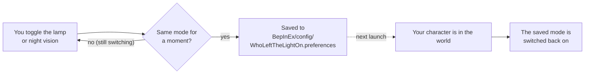

# How It Works

## What's remembered

Whenever you use the game's own controls to toggle the **lamp** or **night vision**, the mod looks at the mode you end
up in. A mode only counts once it has **held for a moment** (about a third of a second), so flicking through the modes
saves the one you stop on, not the ones you pass.

The choice is written to `BepInEx/config/WhoLeftTheLightOn.preferences`, a small text file. There are no other settings.

## When it comes back

On the next launch, once your character is in the world and ready, the saved mode is switched back on **through the
game's own light controls**, exactly as if you had pressed the key. Changes made while it's restoring are ignored for
a moment, so the restore doesn't save itself over your choice.

## What it doesn't do

- It doesn't change how bright or how long-lasting the lights are.
- It doesn't add keys or a menu: you use the game's normal controls.
- It doesn't touch other players: it only remembers your own light.
