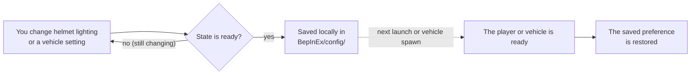

# How It Works

## What is remembered

### Helmet lighting

The mod watches the game's own helmet lamp and night-vision controls. Off, Flashlight, or Night Vision is saved after the mode remains stable briefly, so rapidly cycling through modes does not save an intermediate choice.

### Vehicle preferences

Vehicle preferences are keyed by the game's stable vehicle storage ID:

- Vehicle lights are restored as vehicles spawn, so they can appear on before you mount them.
- Adjustable suction is restored when the vehicle is ready for use.
- Vehicle Boost Lock is remembered separately for each vehicle. With the setting enabled, Left Shift toggles the lock while driving. Braking, stopping, and exiting do not clear the remembered lock; pressing Left Shift again while driving turns it off.

The state is written to `BepInEx/config/WhoLeftTheLightOn.preferences`. It does not modify Moon Sweepers save files.

## Settings

The four functional settings default to On:

| Setting | Purpose |
|---|---|
| **Remember Helmet Lighting** | Restore Off, Flashlight, or Night Vision. |
| **Remember Vehicle Lights** | Restore each vehicle's light state. |
| **Remember Vehicle Suction** | Restore each vehicle's adjustable suction setting. |
| **Vehicle Boost Lock** | Enable the persistent Left Shift boost mode. |

**Clear Remembered Vehicle Settings** is a one-shot reset. Set it to On and apply once; it clears stored vehicle lights, suction, and boost preferences, then returns to Off. Helmet-light memory is not cleared by this action.

## Configuration files

The settings exposed to LunarLink and compatible mod managers are stored in:

`BepInEx/config/tylerun.moonsweepers.wholeftthelighton.cfg`

The remembered runtime state is stored separately in:

`BepInEx/config/WhoLeftTheLightOn.preferences`

## What it does not do

- It does not create custom lighting modes or alter the game's lighting strength.
- It does not refill or change the game's boost resources or physics.
- It does not modify save-game files.
- It does not change other players' equipment or vehicles.
